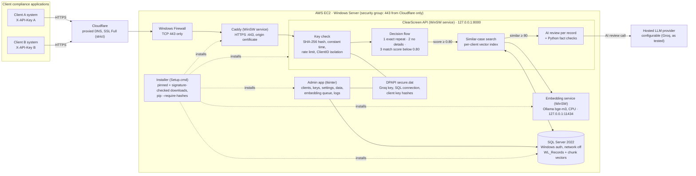

# ClearScreen: Screening-Alert Adjudication API

> A multi-client HTTPS API that checks sanctions and watchlist screening alerts against each client's
> own history of analyst decisions. It clears exact repeats and clear non-matches with deterministic
> rules. For look-alikes of cases an analyst already cleared, an AI reviewer decides whether the
> analyst's reason **still holds**, and Python checks every fact the AI relies on. Every alert comes
> back **CLEAR**, **REVIEW** or **FLAG**, with the reason and the precedent used.


-F55036)
-000000)
-F38020?logo=cloudflare&logoColor=white)


<!-- showcase:banner:start -->
> 🧭 Part of **Abdul Raqeeb Khatri's portfolio**: [📂 Hub](https://github.com/Ark310/portfolio) · [🌐 Site](https://ark310.github.io) · [💼 Experience](https://github.com/Ark310/experience)
<!-- showcase:banner:end -->

> **ClearScreen is a pseudonym; the product's real name is withheld for confidentiality.**
> It is an official product **in production with clients**, deployed on **AWS EC2 (Windows Server)
> behind Cloudflare**. Domains, server addresses, certificates and keys in this repository are
> placeholders.

---

## Overview

Payment and onboarding systems screen every party against sanctions, PEP and adverse-media lists. The
screening engine (here **LexisNexis**) returns *potential matches*, and most of them are false
positives that a compliance analyst still has to clear by hand, often the same customer against the
same listing, month after month.

ClearScreen sits beside the client's compliance application:

1. Clients send the alerts their analysts **cleared**, with the analyst's reason, to
   `POST /whitelist/add`. This is their whitelist.
2. New alerts go to `POST /match/main`. Each one is decided in this order: exact repeat, then no
   listing details, then match score, then similar-case search, then AI review.
3. Uncertain cases always go to a human. The safe failure direction is **more** human review, never
   an automatic clear.

Each client's data is isolated: an API key belongs to one client and can only read that client's
records. Alerts are not stored. The client's own system keeps the decision record.

<!-- showcase:why-impact:start -->
## 💡 Why I Built It

Screening analysts were clearing the same false-positive alerts again and again: the same customer
against the same listing, already cleared before with a written reason. The proof of concept showed
that deterministic checks plus a tightly checked AI review could reuse those past decisions safely,
so I turned it into a product that clients can call, with each client's data kept separate.

## 📈 Impact

- In production with clients on AWS EC2 behind Cloudflare: 9 releases (1.0.0 → 1.5.0) in 9 days,
  installed with one click on Windows Server.
- Exact repeats and clear non-matches are decided in well under a second, with no AI. Anything
  uncertain goes to a human (REVIEW), never to an automatic clear.
- 84 pytest test functions plus an end-to-end smoke test. The demo rehearsal on 1.3.0 gave 38 of 38
  expected results for the deterministic groups and the security checks. The POC flow it grew from
  got 26 of 26 decisions right, with 0 false clears, against 19,992 whitelisted records.

`9 releases in 9 days` · `0 false clears in POC flow test` · `84 tests`
<!-- showcase:why-impact:end -->

## Features

- **Deterministic first.** Exact repeats (SHA-256 `RepeatKey` over normalized fields) and clear
  non-matches (match score < 0.80 from the validated scoring engine) are decided in well under a
  second, with no AI.
- **Validated, frozen scoring engine.** OFAC-style per-token Jaro-Winkler name matching, points for
  country, high-risk country, state, city, DOB and ID, and a LexisNexis listing parser. It is copied
  verbatim from the POC, where it was validated. Any change requires full re-validation.
- **Similar-case search.** The listing is cut into chunks and embedded with bge-m3. Each chunk is
  stored once, keyed by SHA-1. The similarity is computed in both directions, with penalties when
  the name, DOB or country differs. If the entity types differ, the record is rejected.
- **Per-record AI review, fact-checked by Python.** The AI review uses a configurable hosted LLM
  provider (Groq, as tested). It reviews up to 5 similar whitelisted records, one call per
  record, using a strict JSON schema (temperature 0). Python then corrects
  any relationship the data does not support. It also removes reasons that already matched last
  time and adds contradictions it finds, such as an identical ID or a DOB that now matches. A
  reason it cannot confirm is downgraded to MANUAL. If the records disagree, the alert goes to
  REVIEW.
- **Explainable results.** Every result includes `rule`, `explanation`, `score`, `confidence`,
  `repeat_of`, `precedent` and `precedent_reasoning`. The internal `/match/test` endpoint adds the
  score trace, the similar records, each AI answer with Python's corrections, timings and cost. It
  is off by default.
- **Provider-neutral output.** Nothing client-facing names the AI provider. A test checks every
  response, every error and the OpenAPI document.
- **Background embedding queue.** The queue serves the oldest client first, in steps of 100
  records, and can be paused and resumed. Alerts go first: background work waits while an alert is
  searching. The in-memory index grows incrementally, is warmed up at start, and reuses stored
  vectors.
- **Parallel AI calls (1.5.0).** Up to 5 reviews run at once, with an order-preserving map, so the
  decisions are identical to running them one after another.
- **One-click installer and Admin app.** An 18-step, idempotent PowerShell installer, and a tkinter
  Admin app with tabs for Dashboard, Clients, Settings, Data, Embedding and Logs.

## Tech Stack

| Layer | Technology |
|---|---|
| API | Python 3.13, FastAPI, uvicorn, pydantic |
| Matching | rapidfuzz (Jaro-Winkler), numpy, frozen POC scoring engine + LexisNexis listing parser |
| Embeddings | bge-m3 on Ollama, CPU only, `127.0.0.1:11434` |
| LLM | Configurable hosted LLM provider (Groq `qwen/qwen3.8-27b`, as tested), reasoning effort high, temperature 0, strict JSON schema |
| Database | SQL Server 2022 via pyodbc + ODBC Driver 18 (`WL_Records`, `WL_Chunk_Vectors`, `WL_Payload_Chunks`) |
| HTTPS | Caddy 2.11 with a Cloudflare Origin Certificate (PEM or .pfx), or Let's Encrypt |
| Services | WinSW 2.12, three Windows services under virtual service accounts |
| Admin | tkinter desktop app on the server (RDP) |
| Installer | Windows PowerShell 5.1 (`installer/Install-ClearScreen.ps1`) |
| Hosting | AWS EC2 Windows Server 2019/2022/2025 behind Cloudflare |
| Tests | pytest (84 test functions), `tools/smoke_test.py` (end to end, made-up data) |

## Architecture



How an alert is decided (`app/clearscreen/matching.py`):

| Step | Check | Result |
|---|---|---|
| 1 | Exact repeat of a whitelisted record (same client, customer fields and listing) | **CLEAR** `exact_repeat_whitelisted` |
| 2 | Listing says "Entity Details NOT AVAILABLE" | **REVIEW** `no_listing_details` |
| 3 | Match score from the frozen engine < 0.80 | **CLEAR** `score_below_threshold` |
| 4 | No whitelisted record of this client ≥ 80% similar after penalties | **REVIEW** `no_similar_whitelisted` |
| 5 | AI review of the top 5 similar records, each fact-checked by Python | Any confirmed APPLICABLE → **CLEAR**; all NOT_APPLICABLE → **FLAG**; conflict or unsure → **REVIEW** |

More diagrams: [architecture](docs/images/architecture.svg) ·
[decision flow](docs/images/decision-flow.svg) · [client isolation](docs/images/client-isolation.svg).

### Endpoints

| Endpoint | Purpose |
|---|---|
| `POST /whitelist/add` | Add or replace up to 50,000 cleared alerts (with the analyst's reason) |
| `POST /match/main` | Decide up to 500 alerts (1 to 5 recommended, because of Cloudflare's 100 s limit) |
| `GET /whitelist/{ClientID}/{Unique_ID}` | The whitelisted record a decision relied on |
| `GET /search` | The client's most similar whitelisted records for a text |
| `GET /health` | Database, embedding service, AI service, certificate expiry, SQL edition |
| `POST /match/test` | Internal full-detail endpoint. Off by default and hidden from `/docs` while off |

## Getting Started

### Install on a server (production)

The full walkthrough is in the [Installation Guide](docs/1-Installation-Guide.md) (30 to 45 minutes).

1. Copy the package to a Windows Server (2019 or later) that has a data drive (D:). To build a
   package from this repo, add `WinSW-x64.exe` to `installer/vendor/` (see
   [its README](installer/vendor/README.md)).
2. Double-click **Setup.cmd**. Setup asks for the drive, SQL Server (it can install SQL Server 2022
   Developer, but use Standard for production), the domain, the certificate files and the Groq key.
3. In Cloudflare, add a proxied A record for your API domain pointing to the server's Elastic IP
   (`YOUR_ELASTIC_IP`), and set SSL/TLS to Full (strict). In AWS, allow port 443 from Cloudflare's
   IP ranges only, and RDP only from your office IP (`YOUR_OFFICE_IP`).
4. Open **ClearScreen Admin**, then **Clients**, then **Add client**, and give the client its API
   key. The key is shown only once.

### Develop and test locally

```powershell
git clone https://github.com/Ark310/clearscreen.git
cd clearscreen
py -3.13 -m venv .venv
.venv\Scripts\pip install --require-hashes --only-binary=:all: -r app\requirements.lock
.venv\Scripts\pip install pytest
$env:PYTHONPATH = "app"
.venv\Scripts\python -m pytest app\tests -q
```

The tests that need a database use a local SQL Server database called `ClearScreen_Test` (Windows
login), or the connection string in `CLS_TEST_SQL`. Without one, those tests are skipped. The
embedding service and the LLM are always faked. To check a running server end to end with made-up
data, run `tools/smoke_test.py https://api.YOUR_DOMAIN_HERE <ClientID>`.

### Which guide do I need?

| You are... | Read |
|---|---|
| Setting up the server | [1. Installation Guide](docs/1-Installation-Guide.md) |
| Running it day to day (clients, keys, backups) | [2. Administrator Guide](docs/2-Administrator-Guide.md) |
| Connecting a compliance application to the API | [3. Integration Guide](docs/3-Integration-Guide.md) |
| Maintaining or extending the code | [4. Developer Guide](docs/4-Developer-Guide.md) |

The PDF builds of the guides and the screenshots are not published here, because they show the real
product name and domain. `tools/build_docs.py` rebuilds the PDFs from the Markdown.

## Configuration

| What | Where | In this repo |
|---|---|---|
| Plain settings (domain, model, limits, switches) | `<drive>\ClearScreen\Data\config\settings.json`, re-read within ~10 s | [`config/settings.example.json`](config/settings.example.json) |
| Secrets: Groq key, SQL connection string, client key hashes | `<drive>\ClearScreen\Data\config\secure.dat`, DPAPI machine scope, ACL-restricted | never committed |
| HTTPS certificate and key | `<drive>\ClearScreen\Data\config\tls\`, readable only by the HTTPS service | never committed |
| Install locations | `HKLM\SOFTWARE\ClearScreen` | n/a |

Placeholders: `api.clearscreen.example` / `api.YOUR_DOMAIN_HERE` (API domain), `clearscreen.example`
(company domain), `YOUR_ELASTIC_IP`, `YOUR_OFFICE_IP`. Certificates, keys, `secure.dat`, real
`settings.json` files, logs and the `Data` folders are never committed.

## Security design

- **API keys stored as hashes.** A key is `cls_` plus 32 random bytes. It is shown once, and only
  its SHA-256 hash and a hint are stored. The `X-API-Key` header is checked with a constant-time
  comparison **before** the body is parsed. The request's `ClientID` must match the key's client,
  or the request fails with `CLIENT_MISMATCH`.
- **Secrets under DPAPI.** `secure.dat` is encrypted with Windows DPAPI (machine scope, plus app
  entropy), ACL-restricted and written atomically. Secrets reach the setup helpers over stdin,
  never on the command line, and the .pfx password is read at a hidden prompt and never stored.
- **Hash-pinned installs.** Every download (Python, SQL Server ISO, SSMS, ODBC driver, Ollama,
  Caddy, WinSW) is pinned by SHA-256 or SHA-512. Python, the ODBC driver, SQL Server and SSMS
  setup also have their publisher signatures checked. Python packages are installed with
  `pip --require-hashes --only-binary=:all:` from `app/requirements.lock`.
- **Network.** Windows Firewall allows inbound TCP 443 only, and the AWS security group allows
  443 from Cloudflare ranges only, with RDP from the office IP only. The API and the embedding
  service listen on `127.0.0.1`. SQL Server has TCP and named pipes off and uses Windows
  authentication only. The API's database login has only read and write rights on data.
- **Least privilege.** Three services run under virtual service accounts. The certificate key is
  readable only by the HTTPS service, and folder ACLs are set by the installer.
- **API hygiene.** HTTPS only with HSTS. A per-client token-bucket rate limit (120 requests per
  minute), body-size and batch limits, bound SQL parameters, and fixed error codes with reference
  IDs. Access logs never contain headers or bodies.

## Testing

- **84 pytest test functions** (104 test cases after parametrisation) in `app/tests`. They cover
  every endpoint and error code, client isolation, no secrets in responses, storage, upserts and
  repeat keys, embedding cache invalidation, DPAPI, the key lifecycle, TLS and .pfx handling, the
  `/match/main` field set, the test-endpoint switch, provider-neutral output, the growing index,
  pause and resume, alerts-first, and parallel calls giving the same decisions as sequential ones.
- **Portfolio build check (2026-11-17):** on a machine without SQL Server, **48 passed and 56
  skipped** (the skipped tests need the `ClearScreen_Test` database), with **0 failures**.
- **Smoke test.** `tools/smoke_test.py` runs end-to-end checks against any running server using
  made-up `SMOKE-` records: exact repeat, AI clear, AI flag, wrong client and error codes.
- **Demo kit.** [`demo/`](demo/) has a scorecard runner for 7 decision groups and 3 security
  checks, plus Swagger quick tests with made-up `TEST-` people. The demo was rehearsed on 1.3.0:
  groups 1 to 4 and the security checks came out 38 of 38 as expected.

## From POC to product

ClearScreen grew out of **[blns-sanctions-screening-rag](https://github.com/Ark310/blns-sanctions-screening-rag)**,
a proof of concept that ran entirely offline on one workstation (July to October 2026).

| | POC (blns-sanctions-screening-rag) | Product (ClearScreen) |
|---|---|---|
| Goal | Can an LLM help adjudicate screening alerts? | A service clients call in production |
| Data model | LexisNexis export columns, one team's history | Each client's own whitelist (`ClientID`, `Unique_ID`, analyst reasoning), isolated per key |
| Retrieval | Chroma RAG corpus, then SQLite history | bge-m3 chunk vectors in SQL Server, in-memory per-client index |
| LLM | Local Qwen3 8B, then gpt-oss 20B on Ollama | Configurable hosted LLM provider (Groq `qwen3.8-27b`, as tested; picked after side-by-side tests) |
| Role of the LLM | Judge the alert from similar precedents | Answer one narrow question per precedent ("does the analyst's reason still hold?"), checked fact by fact by Python |
| Hosting | Local GPU workstation, .NET reverse proxy on IIS | AWS EC2 Windows Server, Caddy + Cloudflare, WinSW services, one-click installer |
| Kept unchanged | | The scoring engine and LexisNexis parser, copied verbatim and frozen |

The main lessons from the POC: do the decisive work in deterministic Python, use the team's own
past decisions as the evidence, and narrow the LLM's job until every fact it uses can be checked.
In the POC, the 26-alert end-to-end test against 19,992 whitelisted records gave 26 of 26 correct
decisions with 0 false clears.

## Release history

All nine releases shipped in nine days, most of them driven by real installs on the AWS server.
The full notes are in [CHANGELOG.md](CHANGELOG.md).

| Version | Date | Highlights |
|---|---|---|
| 1.0.0 | 2026-11-04 | First release: SQL Server, Windows services, installer, Admin app, four guides |
| 1.1.0 | 2026-11-06 | HTTPS through Cloudflare with a supplied origin certificate; SQL Server 2022 installed by setup (pinned ISO, Windows auth only, network off) |
| 1.2.0 | 2026-11-06 | Everything on a data drive (`D:\ClearScreen\…`), locations in the registry, SSMS 22 and "Open SSMS" in Admin |
| 1.2.1 | 2026-11-06 | Installer fix: folder ACLs only for services that exist; Microsoft Update enabled before SQL Server setup |
| 1.2.2 | 2026-11-06 | Installer fixes: Windows command-line quoting of helper arguments, BOM stripped from the piped Groq key |
| 1.3.0 | 2026-11-06 | .pfx / .p12 certificates (password over stdin, never stored); Caddy stderr no longer treated as failure |
| 1.4.0 | 2026-11-12 | Client-facing `/match/main` vs switchable internal `/match/test`; provider-neutral errors; embedding queue tab with pause/resume; alerts-first |
| 1.4.1 | 2026-11-12 | Disk-space check counts only what this run installs |
| 1.5.0 | 2026-11-12 | Parallel AI calls (1 to 5), stored-embedding reuse, index warm-up at start-up |

The history in this repository was rebuilt from the nine release packages and the demo kit. The
product was not under git, so each release is split into commits, dated from the file modification
times and the CHANGELOG. Files from 1.0.0 carry the time the package was assembled (2026-11-04/05),
not the dates of the earlier development.

## 🤖 Built with AI

Designed and built by Abdul Raqeeb Khatri, with Claude Code and Codex as AI pair-programmers.

| Metric | Value |
|---|---|
| Releases | 9 (1.0.0 → 1.5.0) in 9 days (2026-11-04 → 2026-11-12) |
| Commits in this repo | 32: 28 reconstructed from the release packages and demo kit, plus 4 portfolio commits |
| Code | ~4,250 lines of application code, ~2,300 lines of frozen scoring engine, ~1,150 lines of tests, ~870 lines of installer PowerShell, ~1,300 lines of guides |
| Tests | 84 pytest test functions + an end-to-end smoke test |

Claude Code and Codex were used as pair-programmers across the application, the installer, the tests and
the guides, and for working through failures found on real installs (PowerShell treating Caddy's
stderr as an error, a byte-order mark in piped keys, empty-argument quoting). Session counts are not
given: the product was developed on a separate server whose AI session logs were not part of the
material this repository was built from.

## License

[MIT](LICENSE) © 2026 Abdul Raqeeb Khatri

<!-- showcase:footer:start -->
---

<p align="center"><a href="https://github.com/Ark310/portfolio">← Back to the portfolio hub</a> · <a href="https://ark310.github.io">Interactive site</a> · <a href="https://github.com/Ark310/experience">Experience</a></p>

**Related projects:** [BLNS Sanctions Screening RAG (POC)](https://github.com/Ark310/blns-sanctions-screening-rag) · [BLNS API Bridge](https://github.com/Ark310/blns-api-bridge) · [Local LLM Setup](https://github.com/Ark310/local-llm-setup)
<!-- showcase:footer:end -->
