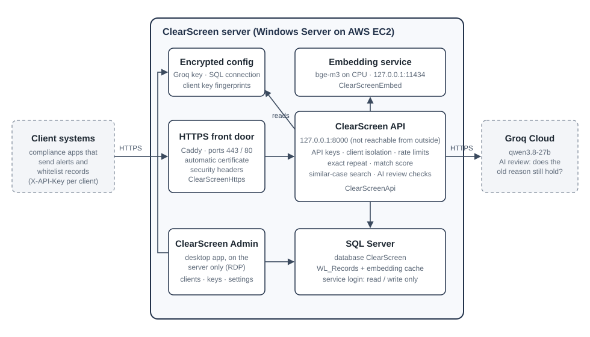

# ClearScreen

ClearScreen checks watchlist screening alerts against each client's own whitelist of earlier
analyst decisions. When an alert looks like one an analyst already cleared, an AI reviewer checks
whether the analyst's reason **still holds** for the new alert, and Python verifies every fact the
AI relies on. Each alert comes back as **CLEAR**, **REVIEW** or **FLAG**, with the reasons.

## Which guide do I need?

| You are... | Read |
|---|---|
| Setting up the server | [1. Installation Guide](docs/1-Installation-Guide.md) |
| Running it day to day (clients, keys, backups) | [2. Administrator Guide](docs/2-Administrator-Guide.md) |
| Connecting a compliance application to the API | [3. Integration Guide](docs/3-Integration-Guide.md) |
| Maintaining or extending the code | [4. Developer Guide](docs/4-Developer-Guide.md) |

PDF versions of every guide are in [docs/pdf](docs/pdf).

## Quick start

1. Copy this folder to a Windows Server (2019 or 2022) with a data drive (D:). Setup installs everything there,
   under `D:\ClearScreen` — including SQL Server 2022 Developer and SQL Server Management Studio if needed.
2. Double-click **Setup.cmd**. Answer the questions (drive, SQL Server, its license, domain, the HTTPS certificate files, Groq key).
3. In Cloudflare, point the domain at the server (proxied, SSL/TLS Full (strict)); in AWS, allow port 443 from Cloudflare only.
4. Open **ClearScreen Admin** (desktop) > **Clients** > **Add client**, and give the client its API key.
5. The client sends whitelist records to `POST /whitelist/add` and alerts to `POST /match/groq`.

## What is in this package

| Path | What |
|---|---|
| `Setup.cmd` | One-click install, upgrade or repair |
| `Uninstall.cmd` | Removes ClearScreen (keeps your data unless you choose otherwise) |
| `installer/` | The setup scripts and the bundled service wrapper |
| `app/` | The ClearScreen application (Python) and its tests |
| `tools/` | `smoke_test.py` (check a running server), `make_lock.py` (dependency lock) |
| `docs/` | The four guides, their images and PDF versions |
| `VERSION` | The version being installed |
