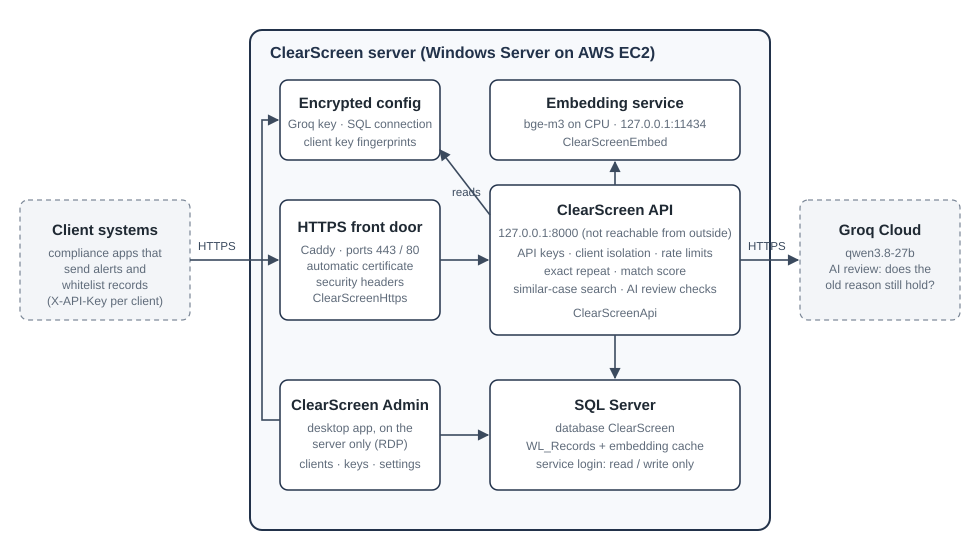

# ClearScreen — Installation Guide

**For:** the person setting up the ClearScreen server. **Time:** about 30–45 minutes, most of it downloads.

---

## 1. What gets installed

One run of **Setup.cmd** installs and configures everything on a single Windows Server:



| Part | What it does | Reachable from outside? |
|---|---|---|
| **HTTPS front door** (Caddy) | Receives all requests on port 443, gets and renews the HTTPS certificate automatically | Yes — ports 443 and 80 |
| **ClearScreen API** | Checks alerts, stores whitelist records, enforces API keys | No — `127.0.0.1:8000` only |
| **Embedding service** (bge-m3 on CPU) | Turns listings into vectors for the similar-case search | No — `127.0.0.1:11434` only |
| **SQL Server 2022** | Stores the whitelist records. Setup installs the free Developer edition if the server has no SQL Server | No — this server only (network access is switched off) |
| **ClearScreen Admin** | Desktop app to manage clients, keys and settings | No — runs on the server only |

The AI review itself runs on **Groq Cloud** over HTTPS. No AI model runs on the server.

---

## 2. Before you start

Work through this checklist first. Setup asks for the items marked ✱.

| | Item | Notes |
|---|---|---|
| ☐ | **An EC2 instance with Windows Server 2019 or 2022** | 4 vCPU / 16 GB RAM recommended when SQL Server runs on the same server (e.g. **t3.xlarge**). 2 vCPU / 8 GB (t3.large) works for small volumes. |
| ☐ | **At least 50 GB disk** (C: drive) | Setup needs 20 GB free when it also installs SQL Server (12 GB otherwise); the database grows with your whitelists. |
| ☐ | **No restart pending** | If Windows Update is waiting for a restart, restart the server first — SQL Server setup refuses to run otherwise. |
| ☐ | **SQL Server** — nothing to prepare | Setup offers to install **SQL Server 2022 Developer** (free) when the server has none. You only have to accept Microsoft's license terms. Already have SQL Server? Setup uses it. ✱ |
| ☐ | **The domain name** | `api.clearscreen.example` by default. ✱ |
| ☐ | **An e-mail address for the certificate** | Let's Encrypt sends expiry warnings here (normally never needed — renewal is automatic). ✱ |
| ☐ | **A Groq API key** | From console.groq.com → API Keys. A paid plan is needed for production volume. ✱ |
| ☐ | **Internet access from the server** | To download Python, the ODBC driver, the embedding service and Caddy. |

**AWS security group** for the instance:

| Port | Source | Why |
|---|---|---|
| 443 (HTTPS) | Anywhere, or your clients' IP ranges | The API |
| 80 (HTTP) | Anywhere | Certificate checks by Let's Encrypt; redirects to HTTPS |
| 3389 (RDP) | **Your office IP only** | Remote desktop for administrators |

Do **not** open 8000, 11434 or 1433 (SQL Server) to the internet.

---

## 3. Install

1. **Copy the ClearScreen folder to the server**, for example to `C:\Install\ClearScreen`.
2. **Double-click `Setup.cmd`.** Windows asks for administrator rights — click **Yes**.
3. **Answer the questions.** Press Enter to accept the value in brackets.

   ```text
   SQL Server instance [localhost]:
   SQL Server is not installed on this server.
   Install SQL Server 2022 Developer now? Free; for development, testing and demos only [Y/n]:
   Public domain name for HTTPS [api.clearscreen.example]:
   E-mail for the HTTPS certificate (Let's Encrypt expiry notices): it@example.com
   ```

   The SQL Server question only appears when the server has no SQL Server yet.

4. **Accept the SQL Server license** (only when setup installs SQL Server). Setup downloads
   SQL Server, opens Microsoft's license terms in a separate window, and asks you to type `ACCEPT`.
   Pressing Enter instead skips SQL Server. The install itself then takes about 10–20 minutes.
5. **Paste the Groq API key when asked.** The input is hidden. Setup tests the key with Groq and
   stores it encrypted. If you skip it, add it later in ClearScreen Admin.
6. **Wait.** Setup shows each step as it goes:

   ```text
   [1] Checking this server
   [2] SQL Server 2022 Developer           SQL Server installed: Developer Edition (64-bit), version 16.0...
   [4] Python 3.13.9                       Python at C:\Program Files\ClearScreen\python
   [5] ClearScreen application files and packages   application 1.0.0 installed, packages verified
   [6] Microsoft ODBC Driver 18 for SQL Server       installed
   [7] Embedding service (Ollama 0.40.14, CPU only)  ready
   [8] HTTPS front door (Caddy 2.11.7)               ready
   [9] Windows services                    ClearScreenApi registered (runs as NT SERVICE\ClearScreenApi)
   [12] SQL Server database (localhost / ClearScreen)   database ready
   [13] Groq API key                        Groq key tested and stored encrypted
   [15] Starting the services               downloading the embedding model bge-m3 (about 1.2 GB) ...
   [17] Health check                        status: ok  (database: ok, embedding service: ok, Groq key: configured)

     ClearScreen 1.0.0 is installed.
   ```

If anything fails, setup stops with a red message and the full log path
(`C:\ProgramData\ClearScreen\logs\install.log`). Fix the problem and run **Setup.cmd** again —
it continues where it left off.

---

## 4. After installing

1. **DNS:** create an **A record** for `api.clearscreen.example` pointing to the server's
   public IP (use an **Elastic IP** in AWS so it never changes). The certificate is issued
   automatically within a minute or two of DNS pointing at the server.
2. **Check HTTPS:** open `https://api.clearscreen.example/health` in a browser. You should see
   `"status": "ok"`.
3. **Add the first client:** open **ClearScreen Admin** from the desktop → **Clients** → **Add client**.
   See the [Administrator Guide](2-Administrator-Guide.md#4-clients-and-api-keys).
4. **Run the smoke test** (optional, recommended) — it proves the whole chain works, with made-up data:

   ```powershell
   $env:CLS_API_KEY = "<the test client's key>"
   & "C:\Program Files\ClearScreen\venv\Scripts\python.exe" tools\smoke_test.py https://api.clearscreen.example TEST-CLIENT
   ```

   It ends with `12/12 checks passed.` Use a dedicated test client: the made-up records stay in its whitelist.

---

## 5. The SQL Server that setup installs

When the server has no SQL Server, setup installs **SQL Server 2022 Developer** like this:

| Setting | Value | Why |
|---|---|---|
| Installation files | Microsoft's ISO from download.microsoft.com, checked against a pinned SHA-256; its `setup.exe` must carry Microsoft's signature | Nothing altered can be installed |
| Components | Database engine only | Nothing extra to patch or secure |
| Sign-in | **Windows sign-in only** — no SQL passwords exist | Nothing to leak or guess |
| SQL administrators | The Windows account that ran setup, and the server's Administrators group | Admins can always manage it; nobody else can |
| Network access | **Off** (TCP/IP and named pipes disabled) | Only programs on this server can reach it; port 1433 is never open |
| Memory | Capped at a quarter of the server's RAM (2–8 GB) | Leaves room for the API and the embedding service |
| Updates | Microsoft's latest updates are included during setup; Windows Update then also delivers SQL Server security fixes | Stays patched |
| Telemetry service | Turned off | Not needed |
| Collation | `SQL_Latin1_General_CP1_CI_AS` (case-insensitive) | What ClearScreen is tested with |

> **Developer edition is for development, testing and demos only.** Microsoft's license does not
> allow it for production — real clients or real customer data. The Admin app's **Health check**
> shows the edition and reminds you while it is Developer.

### Moving to SQL Server Standard (before going live)

The switch keeps the database, the tables, the logins and every record — no reinstall:

1. Buy SQL Server 2022 Standard and get its installation media and product key.
2. Run its `setup.exe` → **Maintenance** → **Edition Upgrade**.
3. Enter the Standard product key, accept the license, select the instance `MSSQLSERVER`, and finish.
4. In **ClearScreen Admin** → **Dashboard**, click **Restart all**, then **Run health check**. It
   should now show `Standard Edition`.

Microsoft supports this Developer → Standard upgrade for SQL Server 2022 on a single server.
Take a **Back up now** (Admin → Data) first, as with any change.

### Connecting from SQL Server Management Studio

Because network access is off, SSMS must run **on the server itself** (over Remote Desktop):
server name `localhost`, **Windows Authentication**. SSMS is not installed by setup; download it
from Microsoft if you need it.

---

## 6. How the installation is protected

| Protection | How |
|---|---|
| Only HTTPS is exposed | The API and embedding service listen on `127.0.0.1` only; the firewall opens 80/443 only |
| Every download is verified | Pinned SHA-256 (or SHA-512) checksums; Python and the ODBC driver must also carry a valid publisher signature |
| Python packages are verified | Installed with `--require-hashes` from an exact lock file |
| Services have minimal rights | Each runs as its own virtual account (`NT SERVICE\ClearScreenApi` …), not as SYSTEM |
| Secrets are encrypted | Groq key, SQL connection and client key fingerprints are encrypted with Windows DPAPI and readable only by administrators and the API service |
| API keys are never stored | Only a SHA-256 fingerprint; the key is shown once when created |
| Database rights are minimal | The API's login can only read and write data — it cannot change the schema |
| The database is not on the network | SQL Server installed by setup accepts local connections only, with Windows sign-in only |
| No request contents in logs | The access log records who called what and the result code, never the data or the key |

---

## 7. Upgrade or repair

Copy the new ClearScreen folder to the server and run its **Setup.cmd**. It stops the services,
updates the program, keeps all settings, clients, keys and data, and starts everything again.

## 8. Uninstall

Run **Uninstall.cmd** (in the package, or in `C:\Program Files\ClearScreen`). It removes the
services, program files, shortcuts and firewall rule. It asks before deleting the settings and
keys. It **never** removes SQL Server or deletes the ClearScreen database — remove SQL Server in
**Settings → Apps** and drop the database in SQL Server Management Studio if you really want them gone.

---

## 9. Troubleshooting the installation

| Message | What to do |
|---|---|
| *Run setup as an administrator* | Start **Setup.cmd** by double-clicking it and accept the Windows prompt. |
| *… download does not match its pinned checksum - refused* | The download was altered or interrupted. Check the server's internet access / proxy and run setup again. |
| *Database setup failed* | Your Windows account cannot sign in to SQL Server, or the instance name is wrong. Fix it, then set the connection in **Admin > Settings** (setup keeps going without it). |
| *Windows has a restart pending* | Restart the server, then run **Setup.cmd** again. |
| *SQL Server setup failed (exit code …)* | Open the `Summary.txt` named in the message; its *Exit message* says why. Fix it and run **Setup.cmd** again. |
| *Installing SQL Server needs at least 20 GB* | Enlarge the EBS volume (AWS console → Volumes → Modify), extend C: in Disk Management, run setup again. |
| *That key did not work* | The Groq key is wrong or expired. Paste it again or press Enter to skip. |
| *The embedding service did not start* | See `C:\ProgramData\ClearScreen\logs\ClearScreenEmbed.err.log`. Usually port 11434 is already used — rerun setup with `-EmbedPort 11435`. |
| *The API did not start* | See `C:\ProgramData\ClearScreen\logs\ClearScreenApi.err.log`. Usually port 8000 is already used — rerun setup with `-ApiPort 8100`. |
| HTTPS does not work | DNS must point to the server, ports 80 and 443 must be open in the AWS security group, and `ClearScreenHttps` must be running. See `https.log`. |

**Setup options** (run from an administrator PowerShell in the package folder):

```powershell
powershell -ExecutionPolicy Bypass -File installer\Install-ClearScreen.ps1 `
    -SqlServer "SQLHOST\INSTANCE" -Database ClearScreen -Domain api.clearscreen.example `
    -AcmeEmail it@example.com -ApiPort 8000 -EmbedPort 11434
```

`-Unattended` runs without questions (set the Groq key afterwards in the Admin app).
`-SkipHttps` leaves out the HTTPS service, for servers behind another proxy or load balancer.
`-InstallSqlServer -AcceptSqlServerLicense` installs SQL Server 2022 Developer without asking (with
`-Unattended`, both are needed); `-NoSqlServerInstall` never offers it.
