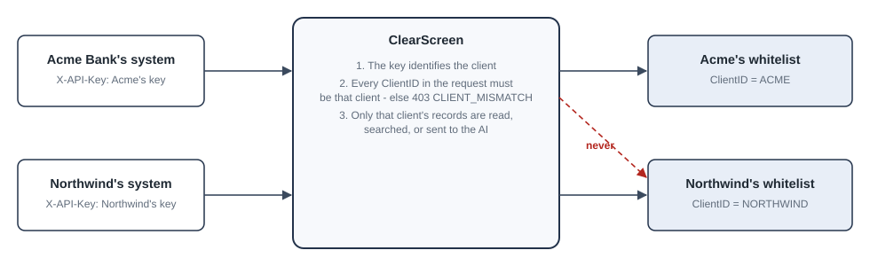

# ClearScreen — Administrator Guide

**For:** whoever runs the ClearScreen server day to day — adding clients, handing out API keys,
keeping it healthy, taking backups.

---

## 1. Opening ClearScreen Admin

1. Connect to the server with **Remote Desktop** (RDP).
2. Double-click **ClearScreen Admin** on the desktop (or find it in the Start menu).
3. Accept the Windows prompt — the app needs administrator rights.

The app works **only on the server itself**. Nobody can reach it over the internet; managing
ClearScreen always means signing in to the server.

The app has six tabs: **Dashboard**, **Clients**, **Settings**, **Data**, **Embedding** and **Logs**.

---

## 2. Dashboard — is everything running?

_(Screenshot not included in the public repository: Dashboard.)_

**Services.** ClearScreen is three Windows services. All three should show **● Running**.

| Service | What it does | If it is stopped |
|---|---|---|
| ClearScreenEmbed | The embedding service used by the similar-case search | Alerts that need the AI cannot find similar records |
| ClearScreenApi | The API itself | Nobody can call ClearScreen |
| ClearScreenHttps | The HTTPS front door | Nobody outside the server can reach the API |

Use **Start**, **Stop** and **Restart** on a row, or **Start all / Stop all / Restart all**. The
services also start automatically when the server boots, and restart themselves if they crash.

**Health check.** Click **Run health check** for a full report:

- each service's state
- the API's own check: database, embedding service, Groq key
- the SQL Server connection, its version and edition, and the number of whitelist records per client.
  While SQL Server is the free **Developer** edition, it reminds you that Developer is for testing
  only — see *Moving to SQL Server Standard* in the Installation Guide
- whether Groq accepts the key and the model is available

Run it after any change, and whenever a client reports a problem.

---

## 3. Settings

_(Screenshot not included in the public repository: Settings.)_

### Groq API key

The key ClearScreen uses to call the Groq AI. **Set / replace key…** asks for the key (input is
hidden), tests it with Groq and stores it encrypted. The API uses a new key from the next request —
no restart needed. **Test key** checks the stored key.

Replace it when Groq tells you it expired, or when someone who knew it leaves.

### SQL Server connection

The connection string the API uses. Passwords are always shown as `********`.

**Edit…** opens the full string. **Test connection** checks it before you save. When saving, the app
offers to create the ClearScreen tables if the database is new, then offers to restart the API.

The default, created by setup, signs in as the API service's own Windows identity — no password:

```text
Driver={ODBC Driver 18 for SQL Server};Server=localhost;Database=ClearScreen;Trusted_Connection=yes;Encrypt=yes;TrustServerCertificate=yes
```

If setup installed SQL Server, it accepts connections from this server only, so this default is
the only connection you need. For a SQL Server on another machine, use a SQL login instead (`UID=...;PWD=...` in place of
`Trusted_Connection=yes`) and give that login only `db_datareader` and `db_datawriter`.

### HTTPS certificate

Shows the installed certificate: the names it covers, who issued it, and when it expires. Clients
reach ClearScreen through Cloudflare, which checks this certificate (a Cloudflare Origin
Certificate for `*.clearscreen.example`).

**Replace certificate…** — for a new certificate (before the old one expires, or if its private key
may have leaked):

1. Get the new certificate from IT: a **.pfx** file and its password, or two **PEM** files (in
   Cloudflare: **SSL/TLS → Origin Server → Create Certificate**). Copy the file(s) to the server.
2. Click **Replace certificate…** and choose the .pfx (you are asked for its password) — or the PEM
   certificate, then its private key.
3. The app checks that they belong together, cover the domain and have not expired, installs them
   and restarts the HTTPS service (a few seconds).
4. **Delete the files you copied** — ClearScreen keeps its own protected copy. The .pfx password is
   not stored and not needed again.

### Address and limits

| Setting | Default | What it means |
|---|---|---|
| Domain name | api.clearscreen.example | The address clients use; the HTTPS certificate must cover it |
| Requests per client per minute | 120 | More than this gets `RATE_LIMITED` for a few seconds |
| Largest request (MB) | 100 | Bigger requests are refused (`REQUEST_TOO_LARGE`) |
| AI reviews per alert (records) | 5 | How many similar whitelist records the AI checks per alert. Fewer = faster and cheaper |
| Publish the API documentation page | on | The interactive documentation at `/docs` (no data is visible without a key) |

**Save and restart services** applies the changes. Callers get errors for the few seconds the
services restart, so do this outside busy hours.

### Test endpoint

ClearScreen has two ways to check alerts:

| Endpoint | Who it is for | What it returns |
|---|---|---|
| `POST /match/main` | Clients — always on | The decision only: `ClientID`, `Unique_ID`, `disposition`, `confidence`, `rule`, `explanation`, `score`, `repeat_of`, `precedent`, `precedent_reasoning` |
| `POST /match/test` | You, for testing — **off** unless you turn it on | The same decision plus every internal detail: the AI provider and model (Groq), AI calls, timings, cost, the similar records found, each AI review and the score trace |

**Turn on** / **Turn off** switches `/match/test`. While it is on, it is listed on the `/docs` page and
any client's key can call it; while it is off, it is hidden from `/docs` and answers `404 NOT_FOUND`,
as if it did not exist. The switch takes effect within 10 seconds, without a restart. Turn it on only
while you test, then off again: it shows clients internal details, including which AI provider is used.
Both endpoints make exactly the same decisions.

---

## 4. Clients and API keys

_(Screenshot not included in the public repository: Clients.)_

Every organisation that calls ClearScreen is a **client**. Each client has:

- a **Client ID** — what it sends as `ClientID` in every request and whitelist record
- a **name** — for you
- **one API key** — its password to the API



A key works **only for its own client**. A request whose `ClientID` is not the key's client is
refused, so one client can never see or use another client's whitelist.

### Add a client

1. **Clients** → **Add client…**
2. Enter the **client name** and the **Client ID**, then **Add client and create API key**.

   _(Screenshot not included in the public repository: Add client.)_

3. The new key is shown **once**:

   _(Screenshot not included in the public repository: The new key, shown once.)_

4. Click **Copy key** and give it to the client **securely** — a password manager share or an
   encrypted message, never plain e-mail or chat. ClearScreen keeps only a fingerprint of the key
   and can never show it again.

> **The Client ID must match.** It is what the client puts in `ClientID`, and what its whitelist
> records carry. Agree it with the client before you create it. Letters, digits, `.`, `_` and `-`;
> upper and lower case are treated as the same.

### Reset a key

Select the client → **Reset API key…**. The old key **stops working immediately**; the new one is
shown once. Do this when a key may have leaked, when someone who knew it leaves, or on a schedule
(for example every 12 months). Tell the client first so they can switch over quickly.

### Disable or enable a client

Select the client → **Enable / disable**. A disabled client's key is refused (`CLIENT_DISABLED`)
but its whitelist records are kept. Use it to pause a client without losing anything.

### Rename or remove a client

**Rename…** changes the name only (never the Client ID).

**Remove client…** deletes the client and its key. You are asked to type:

- `REMOVE` — remove the client but **keep** its whitelist records (re-adding the same Client ID later brings them back)
- `DELETE RECORDS` — remove the client **and permanently delete** all of its whitelist records

---

## 5. Data

_(Screenshot not included in the public repository: Data.)_

### Load whitelist records from Excel

Clients normally send their whitelist records through the API. To load a workbook yourself:

1. **Data** → **Choose Excel file and load…** and pick the `.xlsx` file.
2. Every sheet with a `ClientID` column is read. The columns must be named:
   `ClientID, Unique_ID, Screened_Fields, Screened_Values, Database_Screened, Screened_Date, Matched_Details, Analyst_Allow_Reasoning`.
3. Only rows of **registered clients** are loaded — add the clients first.
4. A `ClientID` + `Unique_ID` that already exists is **replaced** with the new row.

The result shows how many rows were added, replaced and skipped (missing fields, or unknown client).

> **New records become fully searchable after embedding.** The API service works through new records
> in the background. Exact repeats work immediately; the similar-case search uses a record once it
> is embedded. Large loads (100,000+ records) can take several hours on the server's CPU. The
> **Health check** shows progress, and so does `GET /health` with a client's key (`pending_embeddings`).

### Back up and restore the database

**Back up now** writes a full, checksummed backup to SQL Server's backup folder,
`D:\ClearScreen\Backups` (**Open backup folder** shows it). Copy backups off the server — for example to S3 — on a schedule.

**Restore from a backup…** replaces **all** whitelist records with the backup's. You must type
`RESTORE`. The API is stopped during the restore and started again afterwards.

> Client names, API key fingerprints, the Groq key and settings are **not** in the database — they
> stay in `D:\ClearScreen\Data\config` and are encrypted for this server only. Back up the
> whole server (an EC2 AMI, or snapshots of **both** the C: and D: volumes) to protect them too.

### View the raw data (SQL Server Management Studio)

**Open SQL Server Management Studio** opens SSMS connected to the ClearScreen database with your
Windows login. In **Object Explorer**: **Databases → ClearScreen → Tables → dbo.WL_Records** →
right-click → **Select Top 1000 Rows**. Or open **New Query** and run, for example:

```sql
SELECT TOP 100 ClientID, Unique_ID, Screened_Values, Analyst_Allow_Reasoning, UpdatedUtc
FROM dbo.WL_Records WHERE ClientID = 'TEST-CLIENT' ORDER BY UpdatedUtc DESC;
```

| Table | What is in it |
|---|---|
| `dbo.WL_Records` | The whitelist records, one row per `ClientID` + `Unique_ID` |
| `dbo.WL_Payload_Chunks`, `dbo.WL_Chunk_Vectors` | The similar-case search's index (embeddings) — not meant for reading |
| `dbo.CLS_SchemaVersion` | The table layout's version |

If SSMS shows its **Connect** window instead: Server name `localhost`, **Windows Authentication**,
tick **Trust server certificate**, **Connect**.

> You have **full rights** in SSMS. Reading is safe; changing or deleting rows there bypasses
> ClearScreen's checks (for example, a changed record is not re-embedded for the similar-case
> search). Take **Back up now** first, and prefer the API or **Load from Excel** for changes.

---

## 6. Embedding queue

_(Screenshot not included in the public repository: Embedding.)_

New and replaced whitelist records are **embedded** in the background before the similar-case search
(and so the AI review) can use them; the exact-repeat check uses them at once. This tab shows that
queue and lets you pause it.

- **Queue status** at the top: *Running*, *Paused*, *Idle - nothing waiting* or *Problem - retrying*
  (the message says what; see the **API** log).
- **One row per client** with records waiting: how many, how many were embedded so far in this run,
  the **time taken**, an **estimated time left**, and since when records have been waiting. A client
  whose queue finished shows its last run (records and time). The estimate uses the client's own pace
  in this run, measured per listing size, so it settles after the first few minutes; long listings
  (for example WorldCompliance profiles) take several times longer than short ones.
- **Select a client** to see its waiting records (`Unique_ID`, when added or replaced, listing size) in
  the order they will be embedded — the first 1,000.
- **Pause** stops the queue after the current small batch (a few seconds). It stays paused — also
  after a restart of the server — until you click **Resume**. Use it, for example, to give a demo
  full speed, or while a big load would otherwise slow the server.
- The tab refreshes every 15 seconds while it is open; **Refresh** reads it at once.

Clients are worked through **oldest first**, a hundred records at a time. **Alerts always go first:**
while an alert is being checked, the queue waits, so a big load no longer slows down the answers to
alerts. Records waiting are not lost by pausing or restarting.

---

## 7. Logs

_(Screenshot not included in the public repository: Logs.)_

Pick a log and click **Show** (the last 400 lines), or **Open logs folder**
(`D:\ClearScreen\Data\logs`).

| Log | Use it for |
|---|---|
| API | Errors and warnings from the API, including the reference number a caller got with `INTERNAL_ERROR` |
| API access (who called what) | Every request: time, address, endpoint, result code, client, duration. Never the data or the key |
| API service errors / output | Start-up problems |
| Embedding service | Embedding problems |
| HTTPS (Caddy) | Certificate and HTTPS problems |
| Installer | What setup did |

Logs roll over at 10 MB and the last 10 files are kept.

---

## 8. Routine tasks

| When | Task |
|---|---|
| Daily | Glance at the **Dashboard**: three services running |
| Weekly | **Run health check**; check free disk space |
| Weekly | **Back up now** and copy the backup off the server |
| Monthly | Review the client list: disable clients that no longer use the service |
| Every 12 months, or when someone leaves | **Reset API key** for each client; replace the Groq key |
| When a new version arrives | Run its **Setup.cmd** (keeps everything) |

---

## 9. Troubleshooting

| A client reports... | Likely cause | What to do |
|---|---|---|
| `INVALID_API_KEY` | Wrong key, or the key was reset | Check they use the newest key; reset it if unsure |
| `CLIENT_DISABLED` | The client is disabled | **Clients** → **Enable / disable** |
| `CLIENT_MISMATCH` | Their `ClientID` differs from the one registered for their key | Agree the Client ID; it must match exactly (case does not matter) |
| `RATE_LIMITED` | More than the per-minute limit | Raise the limit in **Settings**, or ask them to send batches |
| `AI_LIMIT_REACHED` | Groq's plan limit is used up | Upgrade the Groq plan, or wait for the limit to reset |
| `AI_NOT_CONFIGURED` | No Groq key | **Settings** → **Set / replace key…** |
| `DATABASE_UNAVAILABLE` | SQL Server is down or the connection changed | **Settings** → **Test connection**; check the SQL Server service |
| `INTERNAL_ERROR` with a reference | An unexpected error | Find the reference in the **API** log and send that log section to support |
| Many alerts go to `REVIEW` after a big load | New records are not embedded yet | **Embedding** tab: records waiting and time left. Is the queue paused? |
| `404 NOT_FOUND` on `/match/test` | The test endpoint is switched off | Clients use `/match/main`. To test, **Settings** → **Test endpoint** → **Turn on** |
| Cannot reach the API at all, or Cloudflare error 521 / 522 | A service is stopped, or the Cloudflare DNS record / AWS security group changed | **Dashboard** → **Restart all**; check the HTTPS log |
| Cloudflare error 525 / 526 | Certificate problem | **Settings** → check the certificate line; replace it if expired or wrong |
| Cloudflare error 524 | A request took over 100 seconds | Ask the client to send 1–5 alerts per request |
