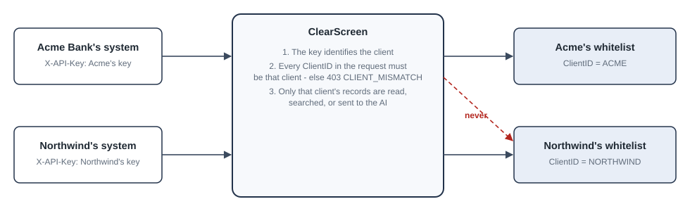
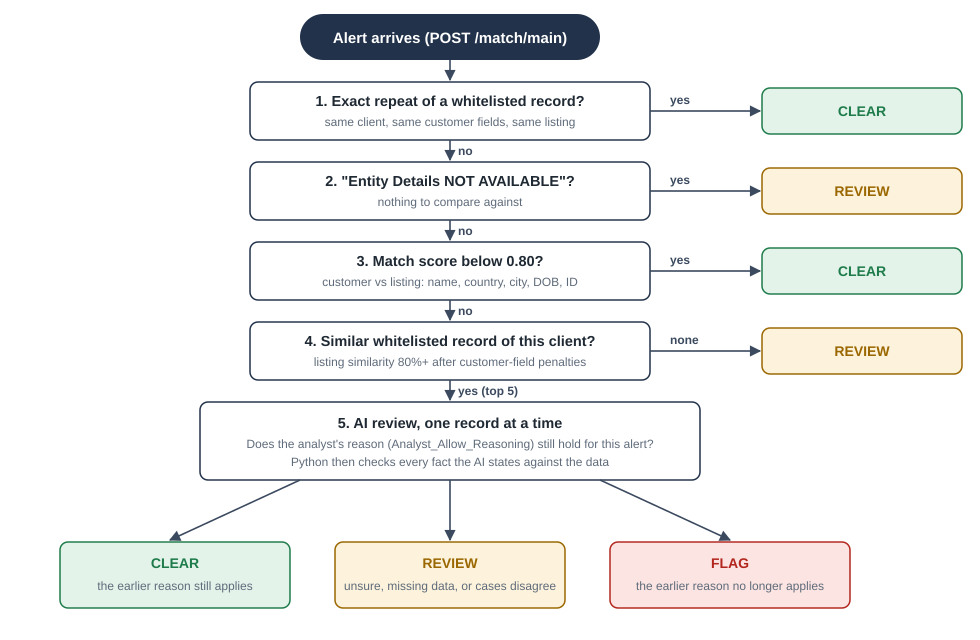

# ClearScreen — Integration Guide

**For:** developers connecting a compliance application to ClearScreen.

---

## 1. In one minute

- **Base URL:** `https://api.clearscreen.example`
- **Every request** carries your API key in the header `X-API-Key`.
- **Every request and record** carries your `ClientID`. It must be the client your key belongs to.
- **Send whitelisted alerts** (with the analyst's reason) to `POST /whitelist/add`.
- **Send new alerts** to `POST /match/main`. Each comes back **CLEAR**, **REVIEW** or **FLAG**, with the reasons.
- All bodies are JSON (`Content-Type: application/json`). Send one object or a list.

```bash
curl -X POST https://api.clearscreen.example/match/main \
  -H "X-API-Key: $CLS_API_KEY" -H "Content-Type: application/json" \
  -d @alert.json
```

---

## 2. Your API key

Your ClearScreen administrator creates your client and gives you a key that starts with `cls_`.

- Keep it **secret** — it is a password. Store it in your secrets manager or an environment
  variable, never in source code, logs or tickets.
- Send it on **every** request: `X-API-Key: cls_...`
- It works **only for your client**. Requests whose `ClientID` is not your client are refused.
- If it may have leaked, ask the administrator to **reset** it. The old key stops working at once.



---

## 3. How an alert is decided



1. **Exact repeat** — the same customer details and the same listing were whitelisted before → **CLEAR**.
2. **No listing details** — LexisNexis gave "Entity Details NOT AVAILABLE" and it is not an exact repeat → **REVIEW**.
3. **Match score** below 0.80 — the customer and the listed party clearly differ → **CLEAR**.
4. **Similar whitelisted record** — none of your whitelist is similar enough → **REVIEW**.
5. **AI review** — for up to 5 similar records, the AI checks whether the analyst's reason
   still holds for this alert; Python checks every fact it states. → **CLEAR**, **REVIEW** or **FLAG**.

### What to do with each result

| Disposition | Meaning | Suggested handling |
|---|---|---|
| **CLEAR** | A false positive: either clearly not the listed party, or an earlier analyst decision still applies | Close the alert automatically. **Keep** `explanation`, `precedent` and `precedent_reasoning` as the audit trail |
| **REVIEW** | ClearScreen cannot decide | Send to an analyst's queue |
| **FLAG** | An earlier whitelist decision **no longer** applies — facts have moved towards the listed party | Send to an analyst **with priority** |

ClearScreen is **advisory**: your compliance policy decides what is closed automatically.

### Teach it your decisions

When an analyst clears a REVIEW or FLAG alert, send that alert to `POST /whitelist/add` with the
analyst's reason in `Analyst_Allow_Reasoning`. The next similar alert can then be cleared
automatically — if the reason still holds.

---

## 4. The record format

Whitelist records and alerts use the same fields. Alerts leave out `Analyst_Allow_Reasoning`.

| Field | Required | What to send |
|---|---|---|
| `ClientID` | Yes | Your client's ID (the one your key belongs to) |
| `Unique_ID` | Yes | **Whitelist record:** its permanent ID — sending the same `ClientID` + `Unique_ID` again **replaces** it. **Alert:** your alert's ID — it is returned with the result so you can match them up |
| `Screened_Fields` | Yes | The screened field names, comma-separated, exactly as your screening system produces them |
| `Screened_Values` | Yes | The values of those fields, comma-separated, in the same order |
| `Database_Screened` | Yes | The list that was hit, e.g. `OFAC SDN.BDF` (stored and returned; not used in matching) |
| `Screened_Date` | Yes | When it was screened (stored and returned; not used in matching) |
| `Matched_Details` | Yes | The full LexisNexis listing text that was hit, unchanged |
| `Analyst_Allow_Reasoning` | Whitelist only | **Why** the analyst cleared it, in plain words. This is what the AI checks — write the actual reason ("Customer born 1980, listed person born 1955") rather than "false positive" |

**Screened fields.** ClearScreen reads your customer from `Screened_Fields` + `Screened_Values`:

| Field names containing... | Read as |
|---|---|
| `Name` (Name, Beneficiary Name, Beneficiary Bank Name, ...) or `First Name` + `Initial` + `Last Name` | Customer name |
| `Country` | Country |
| `Province` or `State` | Province / state |
| `City` | City |
| `Date of Birth`, `Birth` or `DOB` | Date of birth |
| `Passport`, `Identification`, `ID Number`, `Registration` | Identification number |

`First Name` layouts are treated as individuals, bank layouts as organizations. Street, post code,
alias and instruction fields are accepted but not used. A value may contain commas (an address):
the extra pieces are kept with the street / address field so the fields after it stay correct.

Example:

```json
{
  "ClientID": "ACME",
  "Unique_ID": "ALERT-2026-000123",
  "Screened_Fields": "Beneficiary Name,Beneficiary Country,Beneficiary City,Beneficiary Province",
  "Screened_Values": "ACME TRADING LTD,Canada,Toronto,Ontario",
  "Database_Screened": "OFAC SDN.BDF",
  "Screened_Date": "11/04/2026 9:15:02 AM",
  "Matched_Details": "Entity   Name: ACME TRADING LIMITED   Reference No.:10001   Reason: SDGT ... Country: Iran"
}
```

---

## 5. Endpoints

| Method | Path | Purpose |
|---|---|---|
| `POST` | `/match/main` | Check one alert or a list (up to 500) |
| `POST` | `/whitelist/add` | Add or replace whitelist records (one or a list, up to 50,000) |
| `GET` | `/whitelist/{ClientID}/{Unique_ID}` | Read one of your whitelist records |
| `GET` | `/search?q=...&k=10` | Your whitelist records whose listing is most similar to some text |
| `GET` | `/health` | Service status; with your key, also your record count |

Interactive documentation: `https://api.clearscreen.example/docs` — click **Authorize**, paste
your key, then **Try it out** on any endpoint.

_(Screenshot not included in the public repository: Interactive documentation.)_

### POST /match/main

Send one alert object, or a list of them. The response is **always a list**, one result per alert,
in the same order. Each result is the decision on that alert:

_(Screenshot not included in the public repository: Trying /match/main in the documentation page.)_

**Response fields**

| Field | Meaning |
|---|---|
| `ClientID`, `Unique_ID` | Echoed from the alert |
| `disposition` | `CLEAR`, `REVIEW` or `FLAG` |
| `rule` | Why: `exact_repeat_whitelisted`, `no_listing_details`, `score_below_threshold`, `no_similar_whitelisted`, `prior_adjudication_applicable`, `manual_review_required`, `prior_adjudication_not_applicable`, `similar_search_error` |
| `confidence` | 0–1 |
| `explanation` | A readable explanation — store it with the alert |
| `score` | The match score (customer vs listing; 0.80 is the threshold) |
| `repeat_of` | Whitelist `Unique_ID`s this alert exactly repeats |
| `precedent` | The whitelist `Unique_ID` the decision relied on |
| `precedent_reasoning` | That record's `Analyst_Allow_Reasoning` |

Example result (an AI review that found an earlier analyst decision still applies):

```json
[{
  "ClientID": "001",
  "Unique_ID": "DEMO-E-05",
  "disposition": "CLEAR",
  "confidence": 0.9,
  "rule": "prior_adjudication_applicable",
  "explanation": "Score 1.05 is at or above 0.80. The reasoning that whitelisted record 35102 still applies: The prior clearance relied on a location mismatch, and that same Stamford, Connecticut versus Charleston, West Virginia mismatch remains. ...",
  "score": 1.05,
  "repeat_of": [],
  "precedent": "35102",
  "precedent_reasoning": "DIFFERENT LOCATION. GIVEN THE INFORMATION PROVIDED, IT IS UNLIKELY THIS IS A POSITIVE MATCH."
}]
```

**Auto-closing.** Close an alert automatically only when `disposition` is `CLEAR`; send `REVIEW` and
`FLAG` to an analyst. If your policy is stricter, also require a minimum `confidence`, or accept only
some `rule` values.

_(Screenshot not included in the public repository: A live result.)_

### POST /whitelist/add

Send one record or a list. **All records of a request are saved, or none.**

```json
{"added": 1, "replaced": 1, "records": [
  {"ClientID": "ACME", "Unique_ID": "WL-1", "status": "added"},
  {"ClientID": "ACME", "Unique_ID": "WL-2", "status": "replaced"}]}
```

A new or changed record is used by the exact-repeat check **immediately**, and by the
similar-case search once it has been embedded in the background (seconds for a few records, longer
for large loads — see `pending_embeddings` in `GET /health`).

### GET /whitelist/{ClientID}/{Unique_ID}

Returns the stored record, plus `CreatedUtc` and `UpdatedUtc`.

### GET /search

`q` is free text (2–2,000 characters), `k` how many results (1–50). Returns your records with
`Unique_ID`, `similarity` (0–100), `customer` and `Analyst_Allow_Reasoning`.

### GET /health

Without a key: `status` (`ok` or `degraded`) and the state of the database, embedding service and
AI service (`ai_service`). With your key, also `client.whitelist_records` and `client.pending_embeddings`.

---

## 6. Errors

Every error has the same shape — act on `error_code`, show or log `message`:

```json
{"error_code": "CLIENT_MISMATCH", "message": "The ClientID in the request is not the client this API key belongs to."}
```

| HTTP | `error_code` | Meaning | What to do |
|---|---|---|---|
| 400 | `MISSING_CLIENT_ID` | A request or record has no `ClientID` | Fix the data; the message says which record |
| 401 | `INVALID_API_KEY` | Missing or wrong key | Check the key; it may have been reset |
| 403 | `CLIENT_MISMATCH` | A `ClientID` is not your key's client | Use your own Client ID |
| 403 | `CLIENT_DISABLED` | Your client is disabled | Contact the administrator |
| 404 | `NOT_FOUND` | No such record or path | — |
| 413 | `BATCH_TOO_LARGE`, `REQUEST_TOO_LARGE` | Too many items, or the body is over the size limit | Split into smaller requests |
| 422 | `INVALID_REQUEST` | A field is missing or malformed; `errors` lists them | Fix the data |
| 429 | `RATE_LIMITED` | Too many requests per minute | Wait for `Retry-After` seconds, then retry |
| 429 | `AI_LIMIT_REACHED` | The AI review's usage limit is used up for now | `completed` holds the results finished before the limit; resend the `not_run` alerts later |
| 503 | `DATABASE_UNAVAILABLE`, `DATABASE_NOT_CONFIGURED`, `AI_NOT_CONFIGURED` | A part of the service is down or not set up | Retry later; tell the administrator if it persists |
| 500 | `INTERNAL_ERROR` | Unexpected error; the message has a reference number | Retry once; send the reference to the administrator |
| 524 | *(an HTML page from Cloudflare, not JSON)* | The request took longer than 100 seconds, so Cloudflare ended it | Send fewer alerts per request (1–5). The alerts that finished are not returned — send them again |
| 502, 521, 522 | *(Cloudflare page)* | Cloudflare cannot reach ClearScreen right now | Retry later; tell the administrator if it persists |

_(Screenshot not included in the public repository: Error documentation example.)_

**Retrying.** `429`, `502`, `503`, `521` and `522` are temporary — retry with a growing delay (for example 5 s, 15 s,
60 s). Do not retry `400`, `401`, `403`, `413` or `422` unchanged.

---

## 7. Timing, batching and limits

| Item | Limit or typical value |
|---|---|
| Alerts decided without the AI | well under a second each |
| Alerts reviewed by the AI | a few seconds per similar record (up to 5 per alert); more when the AI service is busy |
| **Longest a request may take** | **100 seconds** — Cloudflare, in front of ClearScreen, ends longer requests (error 524) |
| Client timeout | 120 seconds |
| Alerts per `/match/main` request | **send 1–5** so each request finishes within 100 seconds (up to 500 are accepted, but a large batch needing the AI would be cut off by Cloudflare) |
| Records per `/whitelist/add` request | up to 50,000 (5,000 per request is a good size) |
| Request size | 100 MB |
| Requests per minute | 120 per client (ask the administrator to raise it) |

Results come back in the order the alerts were sent; match them by `Unique_ID`.

**Many alerts?** Send them in small requests one after another (or a few in parallel, staying under
the requests-per-minute limit). Alerts decided without the AI return in well under a second, so
most requests are quick; the 1–5 rule protects the ones that need the AI review.

---

## 8. Code examples

All examples read the key from the environment variable `CLS_API_KEY`.

### curl

```bash
curl -s -X POST https://api.clearscreen.example/match/main \
  -H "X-API-Key: $CLS_API_KEY" -H "Content-Type: application/json" \
  -d '{"ClientID":"ACME","Unique_ID":"ALERT-1","Screened_Fields":"Beneficiary Name,Beneficiary Country",
       "Screened_Values":"ACME TRADING LTD,Canada","Database_Screened":"OFAC SDN.BDF",
       "Screened_Date":"11/04/2026","Matched_Details":"Entity   Name: ACME TRADING LIMITED ..."}'
```

### PowerShell

```powershell
$headers = @{ "X-API-Key" = $env:CLS_API_KEY }
$alert = @{
    ClientID = "ACME"; Unique_ID = "ALERT-1"
    Screened_Fields = "Beneficiary Name,Beneficiary Country"; Screened_Values = "ACME TRADING LTD,Canada"
    Database_Screened = "OFAC SDN.BDF"; Screened_Date = "11/04/2026"
    Matched_Details = "Entity   Name: ACME TRADING LIMITED ..."
}
$body = [Text.Encoding]::UTF8.GetBytes(($alert | ConvertTo-Json))
$result = Invoke-RestMethod -Method Post -Uri "https://api.clearscreen.example/match/main" `
    -Headers $headers -ContentType "application/json; charset=utf-8" -Body $body -TimeoutSec 120
$result | ForEach-Object { "{0}: {1} ({2})" -f $_.Unique_ID, $_.disposition, $_.rule }
```

### C# (.NET 6+)

```csharp
using System.Net.Http.Json;

var http = new HttpClient {
    BaseAddress = new Uri("https://api.clearscreen.example"),
    Timeout = TimeSpan.FromSeconds(120)
};
http.DefaultRequestHeaders.Add("X-API-Key", Environment.GetEnvironmentVariable("CLS_API_KEY"));

var alerts = new[] { new {
    ClientID = "ACME", Unique_ID = "ALERT-1",
    Screened_Fields = "Beneficiary Name,Beneficiary Country", Screened_Values = "ACME TRADING LTD,Canada",
    Database_Screened = "OFAC SDN.BDF", Screened_Date = "11/04/2026",
    Matched_Details = "Entity   Name: ACME TRADING LIMITED ..." } };

var response = await http.PostAsJsonAsync("/match/main", alerts);
if (!response.IsSuccessStatusCode) {
    var error = await response.Content.ReadFromJsonAsync<Dictionary<string, object>>();
    throw new Exception($"{(int)response.StatusCode} {error?["error_code"]}: {error?["message"]}");
}
foreach (var r in await response.Content.ReadFromJsonAsync<List<Dictionary<string, object>>>() ?? new())
    Console.WriteLine($"{r["Unique_ID"]}: {r["disposition"]} ({r["rule"]})");
```

### Python

```python
import os
import httpx

api = httpx.Client(base_url="https://api.clearscreen.example",
                   headers={"X-API-Key": os.environ["CLS_API_KEY"]}, timeout=120)

alert = {"ClientID": "ACME", "Unique_ID": "ALERT-1",
         "Screened_Fields": "Beneficiary Name,Beneficiary Country", "Screened_Values": "ACME TRADING LTD,Canada",
         "Database_Screened": "OFAC SDN.BDF", "Screened_Date": "11/04/2026",
         "Matched_Details": "Entity   Name: ACME TRADING LIMITED ..."}

r = api.post("/match/main", json=[alert])
if r.status_code != 200:
    err = r.json()
    raise RuntimeError(f"{r.status_code} {err['error_code']}: {err['message']}")
for result in r.json():
    print(result["Unique_ID"], result["disposition"], result["rule"], result["explanation"])
```

### JavaScript (Node 18+)

```javascript
const res = await fetch("https://api.clearscreen.example/match/main", {
  method: "POST",
  headers: { "X-API-Key": process.env.CLS_API_KEY, "Content-Type": "application/json" },
  body: JSON.stringify([{
    ClientID: "ACME", Unique_ID: "ALERT-1",
    Screened_Fields: "Beneficiary Name,Beneficiary Country", Screened_Values: "ACME TRADING LTD,Canada",
    Database_Screened: "OFAC SDN.BDF", Screened_Date: "11/04/2026",
    Matched_Details: "Entity   Name: ACME TRADING LIMITED ...",
  }]),
  signal: AbortSignal.timeout(120_000),
});
const body = await res.json();
if (!res.ok) throw new Error(`${res.status} ${body.error_code}: ${body.message}`);
for (const r of body) console.log(r.Unique_ID, r.disposition, r.rule);
```

### Adding a whitelist record after an analyst clears an alert (Python)

```python
record = alert | {"Unique_ID": "WL-" + alert["Unique_ID"],
                  "Analyst_Allow_Reasoning": "Customer born 1980-05-10; listed person born 1955. Different person."}
r = api.post("/whitelist/add", json=record)
print(r.json())        # {"added": 1, "replaced": 0, ...}
```

---

## 9. Security checklist for integrators

- ☐ The key is stored in a secrets manager or environment variable — not in code, config files in source control, or logs.
- ☐ Your HTTP client verifies the TLS certificate (the default — do not turn it off).
- ☐ Your logs do not record the `X-API-Key` header.
- ☐ Only your back-end calls ClearScreen — never a browser or mobile app (the key would be exposed).
- ☐ You have a way to switch to a new key quickly if the administrator resets it.

---

## 10. FAQ

**Can we send alerts for several of our clients with one key?** No — one key belongs to one client.
Each client gets its own key.

**Why did an alert that "obviously" matches a whitelisted one come back REVIEW?** Either the record
was added very recently and is not embedded yet (see `pending_embeddings`), or the AI could not
confirm the analyst's reason with the data in the alert. The `explanation` says which.

**What does ClearScreen store?** Only the whitelist records you send to `/whitelist/add`. Alerts sent
to `/match/main` are not stored; the access log records only who called, when, and the result code.

**Is our data sent outside ClearScreen?** For alerts that reach the AI review step (step 5), the
alert and the similar whitelist records (including `Analyst_Allow_Reasoning`) are sent over encrypted
HTTPS to an external AI service for the review. Alerts decided in steps 1–4 are not sent anywhere.
Your ClearScreen administrator can tell you more about the AI service and its data terms.
