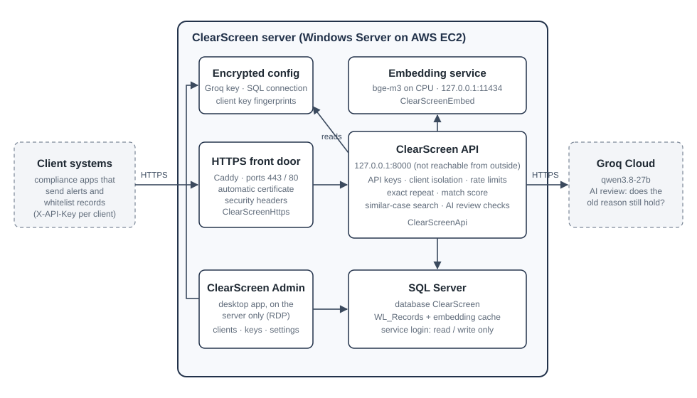
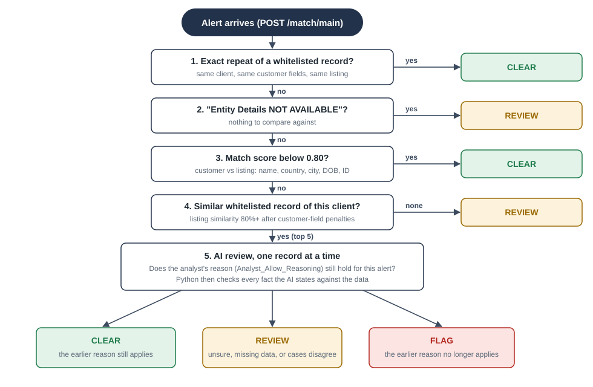

# ClearScreen — Developer Guide

**For:** engineers maintaining, testing or extending ClearScreen.

---

## 1. Architecture



| Component | Technology | Runs as | Listens on |
|---|---|---|---|
| HTTPS front door | Caddy 2.11; supplied certificate (Cloudflare Origin, `tls_mode=certificate`, `auto_https off`) or Let's Encrypt (`tls_mode=automatic`) | `NT SERVICE\ClearScreenHttps` | 0.0.0.0:443 (+ :80 in automatic mode) |
| API | Python 3.13, FastAPI, uvicorn | `NT SERVICE\ClearScreenApi` | 127.0.0.1:8000 |
| Embedding service | Ollama 0.40 + bge-m3, CPU only | `NT SERVICE\ClearScreenEmbed` | 127.0.0.1:11434 |
| Database | SQL Server 2022 (ODBC Driver 18, pyodbc); setup installs Developer edition if none | `NT Service\MSSQLSERVER` | shared memory only (TCP and named pipes off) when setup installed it |
| AI review | Groq Cloud, `qwen/qwen3.8-27b`, strict JSON schema | — | HTTPS out |
| Admin app | Python tkinter (opens SSMS 22 for raw data) | the signed-in administrator | — |

**Locations.** Setup installs under `<drive>\ClearScreen` (default D:): `Program`, `Data`, `SQLServer`,
`SQLData`, `Backups`, `SSMS`. It records them in `HKLM\SOFTWARE\ClearScreen` (`Root`, `InstallDir`,
`DataDir`, `SsmsExe`); `config.data_dir()` reads `CLS_DATA_DIR` (tests), then `DataDir`, then falls back to
`%ProgramData%\ClearScreen` (1.0 layout). `ops.INSTALL_DIR` works the same way with `InstallDir`.

The three services are wrapped by WinSW 2.12 (`D:\ClearScreen\Program\services\*.exe` + `.xml`):
automatic start (delayed), restart on failure (10 s / 30 s / 60 s), logs rolled at 10 MB.

---

## 2. Code layout

```text
app/
  clearscreen/
    api.py            HTTP API: routes, auth, rate limit, error handling, background embedding worker
    matching.py       the decision flow for one alert (steps 1-5)
    similarity.py     similar-case search: chunking, embeddings, scoring, the embedding cache
    ai_review.py      the AI review prompt, its JSON schema, and Python's fact checks
    groq_client.py    Groq API client (strict schema, rate-limit handling, cost)
    db.py             SQL Server schema and data access
    screened.py       our customer, parsed from Screened_Fields / Screened_Values
    security.py       API keys (generate, hash, verify), client admin, rate limiter
    config.py         settings.json and the DPAPI-encrypted secure.dat
    models.py         request / response models (pydantic)
    excel.py          reading whitelist workbooks
    setup_cli.py      setup steps run by the installer
    scoring/          the match-score engine: comparison.py, ln_parser.py (LexisNexis listing
                      parser), text.py, models.py, case.py
    admin/            the Admin app (app.py), its operations (ops.py), service control (services.py)
  tests/              pytest suite (SQL Server test database; AI and embeddings faked)
  requirements.lock   exact, hash-pinned dependencies
installer/            Install-ClearScreen.ps1, Uninstall-ClearScreen.ps1, vendor/WinSW-x64.exe
tools/                smoke_test.py, make_lock.py
```

> **The scoring engine is frozen.** `scoring/comparison.py`, `scoring/ln_parser.py`,
> `scoring/text.py` and `scoring/models.py` are byte-for-byte copies of the validated proof of concept
> (only import lines differ). Change the name scoring only with a full re-validation.

---

## 3. The decision flow (`matching.py`)



1. **Exact repeat.** `db.exact_repeats` looks up `RepeatKey` = SHA-256 of the normalized
   `Screened_Fields`, `Screened_Values` (each comma item trimmed and case-folded) and
   `Matched_Details`, within the client. Indexed: `IX_WL_Records_Repeat (ClientID, RepeatKey)`.
2. **No listing details.** `db.no_listing_details` → REVIEW unless step 1 matched.
3. **Match score.** `scoring.comparison.build_comparison_trace` scores our customer against every
   name / alias / address / DOB / ID row the LexisNexis parser finds in the listing. Below 0.80 → CLEAR.
4. **Similar-case search** (`similarity.find_candidates`). The alert's listing is chunked (header,
   each address / alias / additional-information block, long blocks split at sentences) and
   embedded. Each of the client's embedded records gets a payload similarity: every chunk matched to
   its best chunk on the other side, both directions, averaged (0–100). Penalties on our customer's
   fields when both sides have them: name < 85% −15, DOB differs −25, country differs −10;
   entity type differs → rejected. `adjusted ≥ 80` → sent to the AI (top `ai_max_cases`).
5. **AI review** (`ai_review.review`). One Groq call per record, so reasoning from different records
   is never combined. The prompt gives both sides of the previous and current case, the analyst's
   note, and Python's computed relationships (DOB, country, nationality, city, entity type, ID).
   `python_checks` then corrects any relationship the data does not support, removes reasons that
   matched in the previous case, adds contradictions Python finds (identical ID, DOB now matching,
   entity type changed), and downgrades APPLICABLE to MANUAL when a reason cannot be confirmed or
   no longer applies. Overall: conflicting records → MANUAL; any APPLICABLE → CLEAR (highest
   confidence); all NOT_APPLICABLE → FLAG; else REVIEW.

`groq_client.GroqLimitReached` (a daily limit, or a per-minute limit that does not clear in 60 s)
propagates out of `match_alert` so the API answers `429 GROQ_LIMIT_REACHED` with the completed results.

---

## 4. Data model (SQL Server)

```sql
dbo.WL_Records (
    RecordKey BIGINT IDENTITY        -- internal row number (clustered); used by the embedding cache
    ClientID NVARCHAR(100), Unique_ID NVARCHAR(200)          -- PRIMARY KEY (ClientID, Unique_ID)
    Screened_Fields, Screened_Values, Matched_Details NVARCHAR(MAX) NOT NULL
    Database_Screened NVARCHAR(400), Screened_Date NVARCHAR(100), Analyst_Allow_Reasoning NVARCHAR(MAX)
    RepeatKey BINARY(32)             -- exact-repeat fingerprint, indexed with ClientID
    CreatedUtc, UpdatedUtc DATETIME2 )
dbo.WL_Chunk_Vectors (ChunkHash CHAR(40), Model NVARCHAR(100), Vector VARBINARY(MAX))   -- PK (ChunkHash, Model)
dbo.WL_Payload_Chunks (RecordKey, Model, ChunkNo, ChunkHash)   -- FK RecordKey ON DELETE CASCADE
dbo.CLS_SchemaVersion (Version, AppliedUtc)
```

- Each **distinct** chunk text is embedded once (`ChunkHash` = SHA-1 of the text); vectors are unit
  length float32 (1024 × 4 bytes).
- Replacing a record whose `RepeatKey` changed deletes its `WL_Payload_Chunks`, so the background
  worker re-embeds it.
- The collation's case-insensitivity makes `ClientID` matching case-insensitive; the API also
  replaces a request's `ClientID` with the registered spelling.
- A client's vectors are cached in API memory (`similarity._INDEX`) and reloaded when the count or
  maximum `RecordKey` of its chunks changes.

---

## 5. Configuration and secrets

| File | Contents | Protection |
|---|---|---|
| `D:\ClearScreen\Data\config\settings.json` | Non-secret settings (`config.Settings`) | ACL: Administrators, SYSTEM; API + HTTPS services read |
| `D:\ClearScreen\Data\config\secure.dat` | `groq_api_key`, `sql_connection_string`, `clients` | Same ACL, plus DPAPI machine-scope encryption with app entropy |
| `D:\ClearScreen\Data\config\Caddyfile` | HTTPS configuration (generated by `ops.caddyfile`) | Same ACL |
| `D:\ClearScreen\Data\config\tls\origin.pem`, `origin.key` | The supplied certificate and private key (`ops.install_certificate` checks them with the stdlib `ssl` module first; `ops.install_pfx` unpacks a .pfx with `cryptography`, writes the result to `incoming.*`, runs the same checks and only then replaces the installed pair) | Own ACL: Administrators, SYSTEM, HTTPS service read — **not** the API service |
| `D:\ClearScreen\Data\logs\` | API, access, service, HTTPS and install logs | Services can write |

Both files are re-read when they change — no restart for keys, clients or the Groq key. Writes are
atomic (temp file + replace). `CLS_DATA_DIR` points everything at another folder (tests).

Client entries: `{name, key_hash (SHA-256 hex), key_hint, created_utc, rotated_utc, enabled}`.
Keys are `cls_` + 32 random bytes (URL-safe base64), from `secrets.token_urlsafe`.

---

## 6. Security model

| Threat | Control |
|---|---|
| Access without authorization | `X-API-Key` checked before the body is parsed; constant-time hash comparison |
| One client reading another's data | Every query is filtered by the key's client; request `ClientID`s must equal it (`CLIENT_MISMATCH`) |
| Key theft from the server | Only hashes stored; secrets file DPAPI-encrypted and ACL-restricted |
| Key theft in transit | HTTPS only (HSTS): client → Cloudflare (public certificate) → server (origin certificate, Full strict); the API itself is bound to 127.0.0.1 |
| Bypassing Cloudflare | The origin certificate is trusted only by Cloudflare; the AWS security group allows 443 from Cloudflare's ranges only |
| Keys in logs | Caddy access logging disabled (it would log headers); the API's access log has no headers or bodies |
| Abuse / overload | Per-client token bucket (`rate_limit_per_minute`); body size limit in Caddy and the API; batch limits |
| Information leaks in errors | Fixed error codes; unexpected errors return only a reference ID (details in `api.log`) |
| Over-privileged services | Virtual service accounts; API database login has `db_datareader` + `db_datawriter` only |
| Database reachable from the network | SQL Server installed by setup: `/TCPENABLED=0 /NPENABLED=0`, Windows authentication only, sysadmin = the installing admin + `BUILTIN\Administrators` |
| Tampered downloads | Pinned SHA-256/512; publisher signature check for Python and the ODBC driver, and for `setup.exe` on the SQL Server ISO; `pip --require-hashes` |
| SQL injection | All values are bound parameters; the only identifiers built into SQL (database name in setup) are validated |

---

## 7. Development

```powershell
cd ClearScreen
py -3.13 -m venv .venv-dev
.venv-dev\Scripts\pip install --require-hashes --only-binary=:all: -r app\requirements.lock
.venv-dev\Scripts\pip install pytest
cd app
..\.venv-dev\Scripts\python -m pytest -q
```

The tests use a local SQL Server database `ClearScreen_Test` (Windows login; override with the
`CLS_TEST_SQL` connection string). They fake the embedding service (`tests/conftest.fake_embed`) and
Groq (`tests/test_api.py`), so they are fast and free.

| Test file | Covers |
|---|---|
| `test_api.py` | Every endpoint, keys, client isolation, every error code, the full flow, Groq limits, no secrets in responses |
| `test_storage.py` | Upsert/replace, exact repeat, embedding cache invalidation, matrix = row-by-row similarity, DPAPI, key lifecycle |
| `test_ai_review.py` | The AI review's fact checks and overall decision |

Run the API locally against a test config:

```powershell
$env:CLS_DATA_DIR = "$env:TEMP\cls-dev"
python -m clearscreen.setup_cli settings --domain localhost --api-port 8100
python -m clearscreen.setup_cli sql-init --server localhost --database ClearScreen_Dev --service-login ""
"gsk_..." | python -m clearscreen.setup_cli groq-key
python -m uvicorn clearscreen.api:app --port 8100
```

**End-to-end check** of any running server, with made-up data: `tools/smoke_test.py` (see the
Installation Guide).

---

## 8. Upgrading components

| Component | Where it is pinned | How to upgrade |
|---|---|---|
| Python packages | `app/requirements.lock` | `pip download` the new set for cp313 / win_amd64, run `tools/make_lock.py <folder>`, run the tests |
| Python | `$C.Python` in `Install-ClearScreen.ps1` | New URL + SHA-256; the installer checks the PSF signature |
| ODBC driver | `$C.Odbc` | New URL + SHA-256; Microsoft signature checked |
| SSMS 22 | `$C.Ssms` (bootstrapper `vs_SSMS.exe`) | New URL + SHA-256 from Microsoft's download link (the SHA-256 is part of the URL); Microsoft signature checked. The bootstrapper installs the latest SSMS 22 release |
| SQL Server 2022 Developer | `$C.SqlDev` (ISO) | New ISO URL + SHA-256; the installer checks that `setup.exe` on the ISO is Microsoft-signed. Microsoft's SSEI bootstrapper is deliberately not used: it crashed on Windows Server 2019 during testing |
| Ollama | `$C.Ollama` | Version, URL and SHA-256 from the release's `sha256sum.txt` |
| Caddy | `$C.Caddy` | Version, URL and SHA-512 from the release's checksums file; validate the generated Caddyfile with `caddy validate` |
| WinSW | `installer/vendor/WinSW-x64.exe` + `$C.WinSW.Sha256` | Replace the file and its hash |
| Groq model | `groq_model` in settings.json (`GroqConfig` defaults) | Change, then re-run the validation set before using it in production |

Bump `VERSION` (and `clearscreen.__version__`) for every release.

---

## 9. Extending

- **A new endpoint:** add it to `api.py` with `client_id: str = Depends(require_client)` and filter
  every query by that client. Add its error responses with `_errors(...)` and tests in `test_api.py`.
- **A new screened field:** teach `screened._kind` the field name and map it in `matching.SCORE_FIELDS`
  (if the score should use it) and `ai_review.customer` (if the AI should see it).
- **Another AI provider:** implement a `chat(system, user) -> (json_text, info)` function like
  `groq_client.groq_chat`; raise a subclass of `ai_review.AIProviderLimit` for quota errors.
- **Schema changes:** add statements to `db.SCHEMA` that are safe to re-run, bump `SCHEMA_VERSION`,
  and remember the API's login cannot run DDL — setup / the Admin app apply the schema.

---

## 10. Troubleshooting (developer view)

| Symptom | Where to look |
|---|---|
| A caller got `INTERNAL_ERROR ref=…` | Search `api.log` for the reference: the full stack trace is there |
| Similar records never found | `GET /health` with the client's key → `pending_embeddings`; `api.log` "embedding worker" lines; is `ClearScreenEmbed` running? |
| `DATABASE_UNAVAILABLE` | `ops.test_connection` via Admin > Settings; is `NT SERVICE\ClearScreenApi` a user in the database? |
| Slow AI cases | `waited_seconds` in the result = time spent on Groq's rate limit; `ai_seconds` = model time |
| Service will not start | `logs\<Service>.err.log` and `<Service>.wrapper.log` |
